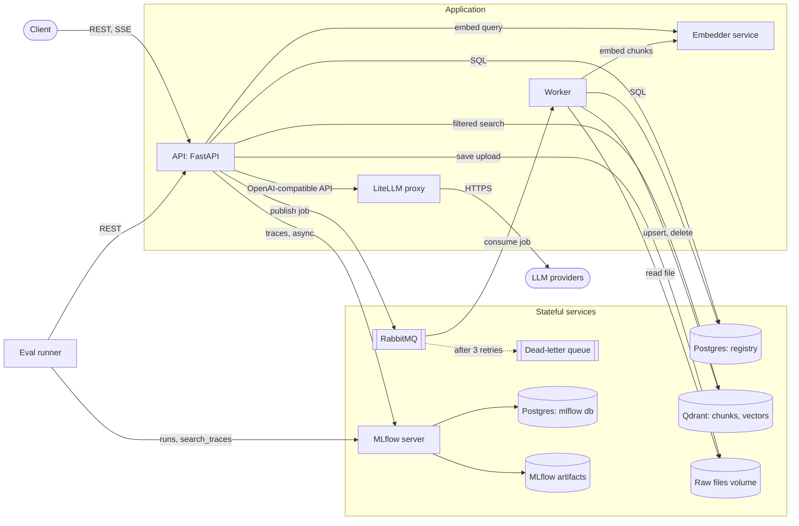
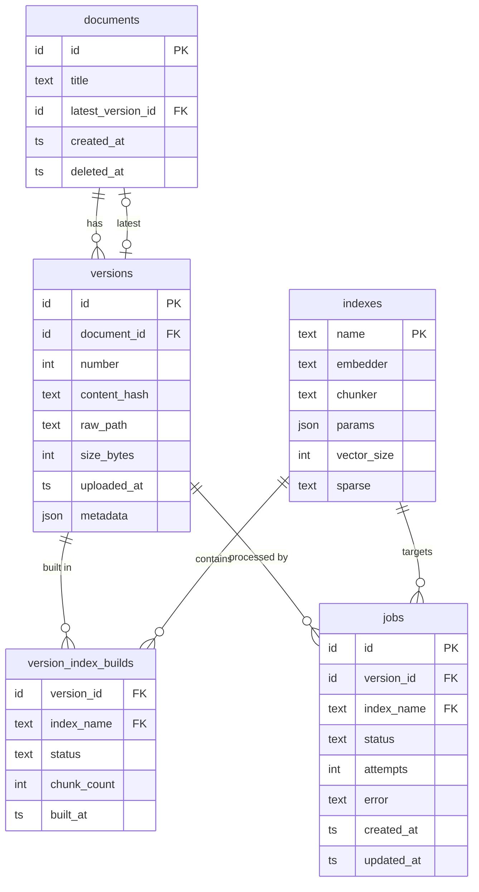
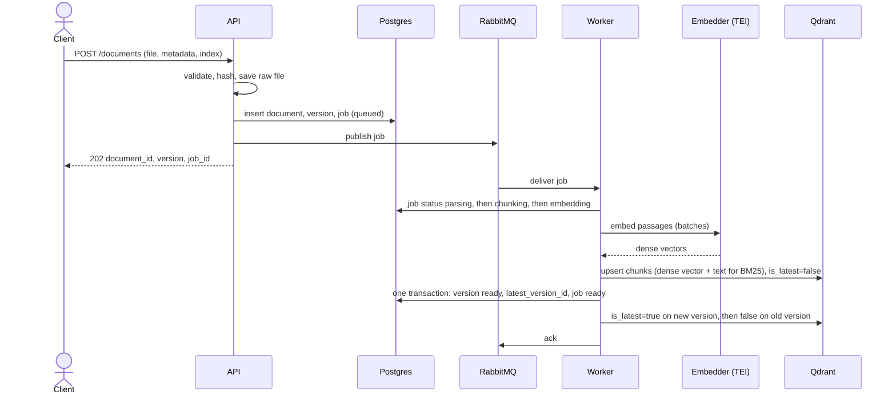
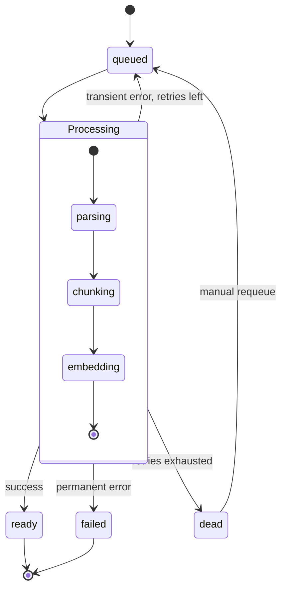
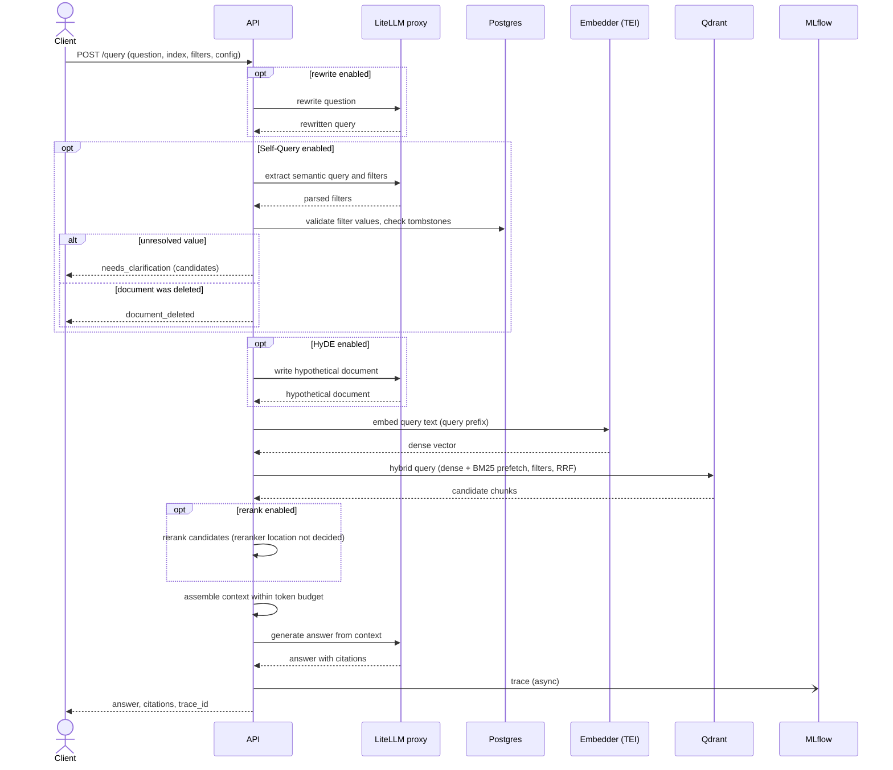

# Architecture

## 1. Components



| From | To | Protocol | Purpose |
|------|----|----------|---------|
| Client, eval runner | API | REST (JSON), SSE for streamed answers | All user-facing operations (ADR-0004) |
| API | RabbitMQ | AMQP | Publish ingestion jobs (ADR-0011) |
| Worker | RabbitMQ | AMQP | Consume jobs, ack after success |
| API, worker | Postgres | SQL | Registry, job status |
| API, worker | Qdrant | gRPC or REST (client library default) | Search (API), upsert and delete (worker) |
| API, worker | Embedder service (Hugging Face TEI) | HTTP | Embed queries and HyDE text (API), chunks (worker) (ADR-0012) |
| API | LiteLLM proxy | HTTP (OpenAI-compatible) | Rewriting, Self-Query parsing, HyDE, generation (ADR-0016) |
| LiteLLM proxy | LLM providers | HTTPS | Forward calls to the configured provider and model |
| API, eval runner | MLflow | HTTP | Traces (API), runs and trace search (eval) (ADR-0015) |

Notes:
- **SSE, not WebSockets.** Streaming is one-way (server to client), and SSE works over plain HTTP.
- **One image, two processes.** API and worker are separate containers built from the same package (see section 7).
- **Raw files** live on a Docker volume mounted into both API and worker (ADR-0017).

## 2. Data model

### Postgres (registry)

Draft tables and key columns. Exact types and constraints are **TODO(author)**.

| Table | Key columns |
|-------|-------------|
| `documents` | `id`, `title`, `latest_version_id`, `created_at`, `deleted_at` |
| `versions` | `id`, `document_id`, `number`, `content_hash`, `raw_path`, `size_bytes`, `uploaded_at`, `metadata` (JSONB: `doc_type`, `tags`, `author`, `doc_date`, `language`) |
| `indexes` | `name`, `embedder`, `chunker`, `params` (JSONB), `vector_size`, `sparse` (`bm25`) |
| `version_index_builds` | `version_id`, `index_name`, `status`, `chunk_count`, `built_at` |
| `jobs` | `id`, `version_id`, `index_name`, `status`, `attempts`, `error`, `created_at`, `updated_at` |

- **Job status** values: `queued`, `parsing`, `chunking`, `embedding`, `ready`, `failed`, `dead` (story A2, ADR-0011).
- **Source of truth for "latest"** is `documents.latest_version_id` (ADR-0014).
- **Known filter values** (for Self-Query validation, ADR-0008) are derived with `SELECT DISTINCT` over latest-version metadata, plus tombstone titles for story A6. No separate synced table.
- MLflow uses its own database in the same Postgres instance.

Draft entity relationships. Column types are illustrative and the real ones are **TODO(author)**. `documents.latest_version_id` and `versions.document_id` reference each other.



### Qdrant (chunks and vectors)

- **One collection per index config** = (embedding model, chunking strategy and params), named like `chunks_<embedder>_<chunker>_<params>` (ADR-0013). The same document version can be built in several indexes.
- **Named vectors per point** (ADR-0018): `dense` (size taken from the index's embedder) and sparse `bm25` (BM25 over the chunk text, IDF modifier on the sparse vector config). Both are defined when the collection is created, even if an index is queried in dense mode only.
- **Payload:** `document_id`, `version`, `is_latest`, `doc_type`, `tags`, `author`, `doc_date`, `language`, `section_path`, `chunk_index`, `text`.
- **Point id:** deterministic UUID v5 from (version id, index, chunk index), so retried upserts overwrite.
- **Payload indexes** on every filtered field (verify the exact setup in the Qdrant docs).
- **`is_latest` in the payload** is a denormalized copy for fast filtering. Postgres is the truth.

### Consistency (ADR-0014)

No transaction spans Postgres and Qdrant. A unit of work is used inside Postgres only. Ingestion order:

1. Write vectors with `is_latest=false` (invisible to default queries).
2. One Postgres transaction: mark the version ready, move `latest_version_id`, finish the job.
3. Set `is_latest=true` on the new version's points, then `false` on the old version's points.

Failure at step 1 or 2: delete points by `version_id` and mark the job failed, or retry (idempotent). Failure at step 3: retry. A reconciler repairs mismatches between the stores, and an invariant check verifies exactly one latest version per document in both.

### Deletion

1. Mark the document deleted in Postgres (hidden from lists and retrieval).
2. Delete its vectors from every index, then its raw files.
3. Remove versions and metadata, keep the tombstone (`id`, `title`, `deleted_at`).

Every step is idempotent, so a retry resumes after a failure. Stories A3 and A6, Flow 7.

## 3. Ingestion pipeline

Runs in the worker. A job is delivered through RabbitMQ and processed in stages, each with a typed input and output:

`file bytes` -> `ParsedDocument` -> `list[Chunk]` -> `list[EmbeddedChunk]` -> upsert

- **Parsers** for `.md` and `.docx` produce the same `ParsedDocument` (front matter metadata, sections with heading paths), so later stages do not care about the format (ADR-0001).
- **Chunker** is the swappable stage. The strategy belongs to the index, chosen at upload by selecting the target index (ADR-0013).
- **Embedder** is called over HTTP in batches (ADR-0012). TEI also batches dynamically on the server side across concurrent requests. Many models need different prefixes for queries and passages, so the `Embedder` interface has separate query and passage methods.
- **Upsert** writes the dense vector from the embedder and the BM25 sparse vector for the same chunk text (ADR-0018). Qdrant computes the BM25 sparse vector itself from the chunk text (a `Document` with model `Qdrant/bm25`, available on self-hosted instances per the docs), so `EmbeddedChunk` stays dense only and TEI is not involved.
- Field-level definitions of `ParsedDocument`, `Chunk` and `EmbeddedChunk`: **TODO(author)**.

Ingestion sequence (success path):



Job status transitions (retry and dead-letter rules are in the list below):



**Retry and failure policy** (ADR-0011):
- Up to 3 retries with exponential backoff for transient errors (embedder or Qdrant unavailable).
- Permanent errors (unparseable or empty file) fail immediately, no retries.
- After the retries the message goes to the dead-letter queue and the job status becomes `dead`, with the error recorded. There must be a way to requeue it.
- The consumer acks only after the work finishes (prefetch 1) and checks job status on start, since delivery is at-least-once.
- A republisher re-sends jobs stuck in `queued` past a timeout (the API commits to Postgres before publishing).

## 4. Query pipeline

A fixed sequence of stages, each switchable by config (ADR-0010). A stage is one step that takes a shared state object, returns it updated, and writes its own trace entry.

Stages in order: query rewriting, Self-Query, HyDE, retrieve (`dense`, `sparse` or `hybrid`), rerank, context assembly, generate. Each can be turned on or off per request (stories D2 to D6).

TODO(author):
- Fields of the shared `PipelineState` and which stage writes each field.
- Stage interface (input type, output type).
- Expected shapes at boundaries: embedding vector size (taken from the index), number of chunks passed between stages, token budget for context.

**Hybrid retrieval** (ADR-0018): one Qdrant query with a `prefetch` branch per vector (`dense` and `bm25`, each with its own limit), merged by Reciprocal Rank Fusion. The text used differs per branch:
- Dense branch: the HyDE document if present, else the Self-Query semantic query, else the rewritten query, else the question.
- Sparse branch: the Self-Query semantic query, else the rewritten query, else the question. Never the HyDE text. This is a hypothesis to test on the golden set.

Retrieve config: `mode` (`dense`, `sparse`, `hybrid`), `fusion`, per-branch limit, final `top_k`. The evaluation baseline stays dense only.

Query sequence (stages in brackets are optional and switched by config):



**Traces** (ADR-0015): MLflow Tracing, one span per stage, with inputs, outputs, latency and token usage. The trace id returned by `POST /query` is the MLflow trace id. The eval runner reads traces with `mlflow.search_traces`. The API uses the lightweight `mlflow-tracing` package with async logging. Prometheus and Grafana for RPS and failure rates are deferred.

**Deleted documents** (story A6): if Self-Query resolves a document name to a tombstone, the pipeline stops after that stage and returns a `document_deleted` response.

## 5. API contract

FastAPI generates the OpenAPI schema from Pydantic models. The exported `openapi.json` is committed so contract changes show in diffs. Draft endpoints:

| Method | Path | Purpose | Request | Response |
|--------|------|---------|---------|----------|
| POST | `/documents` | Upload a new document | multipart: `file`, `metadata` (JSON), `index` (optional) | 202: `document_id`, `version`, `job_id` |
| POST | `/documents/{id}/versions` | Upload a new version | same as above | 202: as above, or 200 `no_changes` if the content hash is identical |
| GET | `/documents` | List documents | query: filters, `include_deleted` | list of documents |
| GET | `/documents/{id}` | Document details | | document with latest version and build statuses |
| GET | `/documents/{id}/versions` | Version history | | list of versions |
| DELETE | `/documents/{id}` | Delete a document (tombstone stays) | | 202 |
| GET | `/jobs/{id}` | Ingestion job status | | `status`, `attempts`, `error` |
| GET | `/indexes` | List available indexes | | list of index configs |
| POST | `/indexes` | Create an index (collection in Qdrant plus a registry row) | `name`, `embedder`, `chunker`, `params` | 201: index config |
| POST | `/query` | Ask a question | `question`, `index`, `filters`, `version`, pipeline config (stage toggles) | one of three responses below |
| POST | `/query/stream` | Same as `/query`, streamed over SSE | same as `/query` | `text/event-stream`: token events, then a final event with the same union as `/query` |
| GET | `/health` | Liveness and dependency check | | status |

`POST /query` returns a discriminated union on `status`, because each case is a normal outcome and not an error:
- `answer`: answer text, citations (document, version, section, quoted chunk), `trace_id`.
- `needs_clarification`: the filter field, the value that could not be resolved, a list of nearest candidates, `trace_id`. The client resends the request with the chosen value (ADR-0008).
- `document_deleted`: document title, `deleted_at`, `trace_id` (story A6).

TODO(author): the exact shape of the pipeline config object, SSE event names and payloads, and what happens to documents when an index is deleted (no delete endpoint yet).

## 6. Evaluation runner

- Calls the API over HTTP, so it exercises the real environment. This needs `POST /query` to accept a per-request pipeline config, and uses the `trace_id` to read retrieved chunks from MLflow.
- Configs and seeds live in YAML under `eval/configs/`. The golden set lives under `eval/golden/` and is versioned in git (ADR-0005).
- Each run is an MLflow run: pipeline config as params, metrics, and the report and golden set version as artifacts, together with the raw per-question outputs that metrics are computed from (ML_DESIGN section 6, run records). Reports are generated artifacts, named with config hash and git sha.
- Repeat runs and report variance. API LLMs are not deterministic, and the chosen models do not accept sampling settings.
- The pipeline stays importable as a package, so stages can be unit tested without HTTP.

## 7. Project layout

```
rag-qa-system/
  src/ragqa/
    api/          FastAPI app, routers, request and response schemas
    worker/       RabbitMQ consumer, republisher, job handling, entrypoint
    domain/       pure types: ParsedDocument, Chunk, PipelineState, configs
    ingestion/    parsers/ (md, docx), chunkers/, ingestion pipeline
    query/        stages/ (rewrite, self_query, hyde, retrieve, rerank, context, generate), runner
    storage/      postgres/ (models, repositories, unit of work), qdrant/ (index management, upsert, search), files/
    embeddings/   Embedder interface, in-process and remote implementations
    llm/          LLM client interface, OpenAI-compatible client for the LiteLLM proxy
    evaluation/   golden-set tooling shared by tests and the eval runner (evidence quote validator)
    settings.py   config loading
  eval/
    golden/       questions (versioned)
    configs/      pipeline configs (yaml)
    runner/       HTTP runner, metrics, MLflow logging
    reports/      generated
  migrations/     Alembic
  tests/          unit/, integration/
  deploy/         docker-compose.yml, Dockerfiles
  docs/
  pyproject.toml
```
