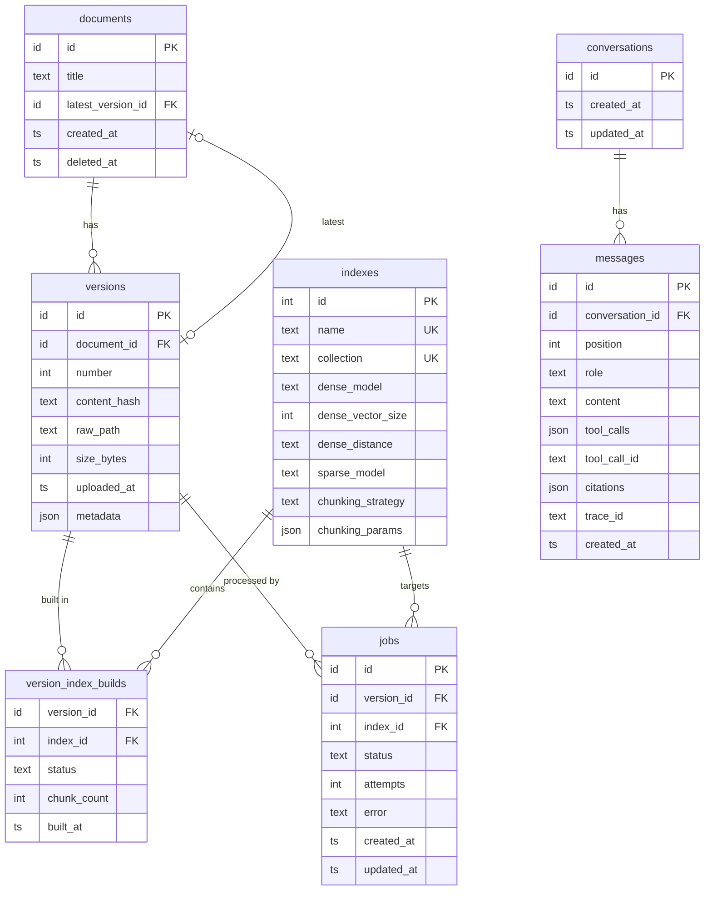
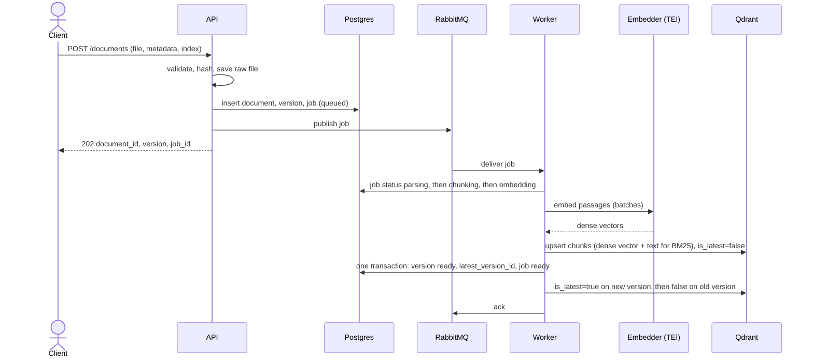
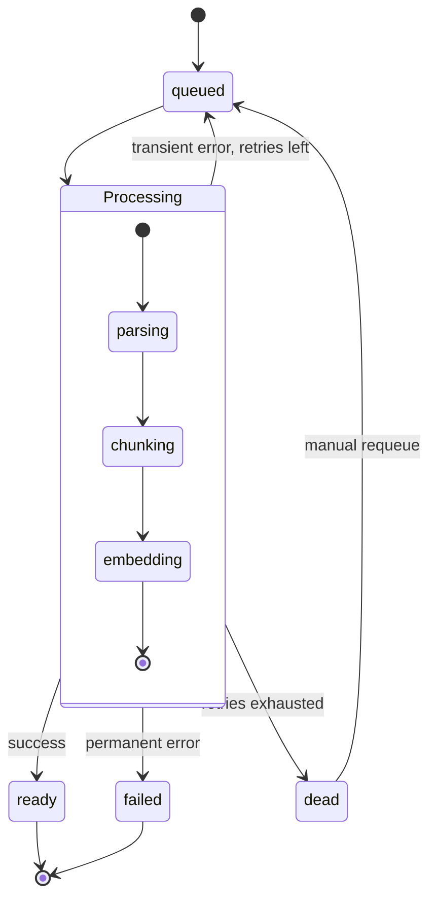
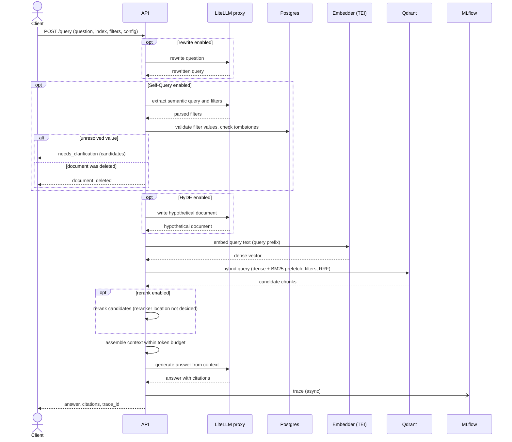

# Architecture

## 1. Components


| From | To | Protocol | Purpose |
|------|----|----------|---------|
| Client, eval runner | API | REST (JSON), SSE for streamed answers | All user-facing operations (ADR-0004) |
| API | RabbitMQ | AMQP | Publish ingestion jobs (ADR-0011) |
| Worker | RabbitMQ | AMQP | Consume jobs, ack after success |
| API, worker | Postgres | SQL | Registry, job status |
| API, worker | Qdrant | gRPC or REST (client library default) | Search (API), upsert and delete (worker) |
| API, worker | Embedder service (Hugging Face TEI) | HTTP | Embed queries and HyDE text (API), chunks (worker) (ADR-0012) |
| API | LiteLLM proxy | HTTP (OpenAI-compatible) | Rewriting, Self-Query parsing, HyDE, generation (ADR-0016) |
| LiteLLM proxy | LLM providers | HTTPS | Forward calls to the configured provider and model |
| API, eval runner | MLflow | HTTP | Traces (API), runs and trace search (eval) (ADR-0015) |

Notes:
- **SSE, not WebSockets.** Streaming is one-way (server to client), and SSE works over plain HTTP.
- **One image, two processes.** API and worker are separate containers built from the same package (see section 7).
- **Raw files** live on a Docker volume mounted into both API and worker (ADR-0017).

## 2. Data model

### Postgres (registry)

| Table | Key columns |
|-------|-------------|
| `documents` | `id`, `title`, `latest_version_id`, `created_at`, `deleted_at` |
| `versions` | `id`, `document_id`, `number`, `filename`, `source_format`, `content_hash`, `raw_path`, `size_bytes`, `uploaded_at`, `metadata` (JSONB: `doc_type`, `tags`, `author`, `doc_date`, `language`) |
| `indexes` | `id` (bigint identity), `name` (unique), `collection` (unique, the Qdrant collection), `dense_model`, `dense_vector_size`, `dense_distance` (default `cosine`), `sparse_model` (`Qdrant/bm25`), `chunking_strategy`, `chunking_params` (JSONB) |
| `version_index_builds` | `version_id`, `index_id`, `status`, `chunk_count`, `built_at` |
| `jobs` | `id`, `version_id`, `index_id`, `status`, `attempts`, `error`, `created_at`, `updated_at` |
| `conversations` | `id`, `created_at`, `updated_at` |
| `messages` | `id`, `conversation_id`, `position` (unique per conversation), `role` (`system`, `user`, `assistant`, `tool`), `content`, `tool_calls` (JSONB), `tool_call_id`, `citations` (JSONB), `trace_id`, `created_at` |

- **Schema in code:** models in `src/ragqa/storage/postgres/models/` (one module per area), migrations in `src/ragqa/storage/postgres/migrations/` (inside the package, so the image carries them). Compose runs a one-shot `migrate` service (`python -m ragqa.storage.postgres.migrate`) before the API and worker start. An integration test runs `alembic check`, so models and migrations cannot drift apart.
- **Registry operations** are in `src/ragqa/storage/postgres/registry.py`, one transaction each: create a document or the next version with a queued job (identical content to the newest version returns nothing, story B1; the document row is locked so concurrent uploads number versions correctly), job attempts and status, `complete_build` (ADR-0014 step 2: an older version finishing late never takes the latest pointer back), stuck queued jobs for the republisher, tombstone and purge.
- **Conversations** (story C4): the API appends the user message and the assistant message (with its citations and `trace_id`) after each answer, in one transaction (`append_messages`). The conversation row is locked while appending, so concurrent requests get distinct `position` values. Tool calls and tool results are stored as their own messages, so a turn that used a tool replays exactly. Citations are kept for the client and never sent back to the model. A pipeline stage never writes to the database.
- **Job status** values: `queued`, `parsing`, `chunking`, `embedding`, `ready`, `failed`, `dead` (story A2, ADR-0011).
- **Source of truth for "latest"** is `documents.latest_version_id` (ADR-0014).
- **Indexes have a surrogate key.** Foreign keys point at `indexes.id`, so renaming an index or re-creating one with the same name never re-attaches old jobs and builds. The API accepts the index `name` and resolves it to the id. Logs and metric labels carry the name. Sparse vectors have no fixed size, so there is no sparse size column.
- **Known filter values** (for Self-Query validation, ADR-0008) are derived with `SELECT DISTINCT` over latest-version metadata, plus tombstone titles for story A6. No separate synced table.
- MLflow uses its own database in the same Postgres instance.



### Qdrant (chunks and vectors)

- **One collection per index config** = (embedding model, chunking strategy and params), named like `chunks_<embedder>_<chunker>_<params>` (ADR-0013). The same document version can be built in several indexes.
- **Named vectors per point** (ADR-0018): `dense` (size taken from the index's embedder) and sparse `bm25` (BM25 over the chunk text, IDF modifier on the sparse vector config). Both are defined when the collection is created, even if an index is queried in dense mode only.
- **Payload:** `document_id`, `version`, `is_latest`, `doc_type`, `tags`, `author`, `doc_date`, `language`, `section_path`, `chunk_index`, `text`.
- **Point id:** deterministic UUID v5 from (version id, index id, chunk index), so retried upserts overwrite. The index **id** is used, not its name, so renaming an index never changes point ids.
- **Payload indexes** on every filtered field (verify the exact setup in the Qdrant docs).
- **`is_latest` in the payload** is a denormalized copy for fast filtering. Postgres is the truth.

### Consistency (ADR-0014)

No transaction spans Postgres and Qdrant. A unit of work is used inside Postgres only. Ingestion order:

1. Write vectors with `is_latest=false` (invisible to default queries).
2. One Postgres transaction: mark the version ready, move `latest_version_id`, finish the job.
3. Set `is_latest=true` on the new version's points, then `false` on the old version's points.

Failure at step 1 or 2: delete points by `version_id` and mark the job failed, or retry (idempotent). Failure at step 3: retry. A reconciler repairs mismatches between the stores, and an invariant check verifies exactly one latest version per document in both.

### Deletion

1. Mark the document deleted in Postgres (hidden from lists and retrieval).
2. Delete its vectors from every index, then its raw files.
3. Remove versions and metadata, keep the tombstone (`id`, `title`, `deleted_at`).

Every step is idempotent, so a retry resumes after a failure. Stories A3 and A6, Flow 7.

## 3. Ingestion pipeline

Runs in the worker. A job is delivered through RabbitMQ and processed in stages, each with a typed input and output:

`file bytes` -> `ParsedDocument` -> `list[Chunk]` -> `list[EmbeddedChunk]` -> upsert

- **Parsers** for `.md` and `.docx` produce the same `ParsedDocument`, so later stages do not care about the format (ADR-0001, ADR-0021). They live in `src/ragqa/ingestion/parsers/` behind a registry keyed by file extension, which the API also uses to reject unsupported uploads. Markdown text is close to the rendered page: front matter becomes metadata, inline markup and Hugo shortcodes are removed (a `glossary_tooltip` keeps its `text`, else its `term_id`), heading anchors `{#id}` are dropped, and code blocks and tables keep their content. The Kubernetes pages use shortcodes that need other files (code samples, includes, headings from translation strings), so the corpus is rendered to plain Markdown before ingestion (`ragqa.evaluation.corpus`, ML_DESIGN section 3).
- **Chunker** is the swappable stage. The strategy belongs to the index, chosen at upload by selecting the target index (ADR-0013). The worker builds the chunker for each job from a registry (`src/ragqa/ingestion/chunkers/`) using the index's `chunking_strategy` and `chunking_params`, and a `TokenCounter` for the index's embedder tokenizer. Both are supplied by `Backends`; a job fails permanently while no strategy or no counter is registered. The result is checked by `check_chunks`. Two strategies exist, both thin adapters over LangChain's text splitters (`langchain-text-splitters`) in `src/ragqa/ingestion/chunkers/langchain_chunkers.py`:
  - `fixed-size` (the baseline of ADR-0019): windows of `chunk_chars` characters (default 1200) with `overlap_chars` overlap (default 150), cut at the nearest space, ignoring structure.
  - `recursive`: splits on blank lines, then lines, then spaces until each piece fits `chunk_tokens` tokens (default 256) with `overlap_tokens` overlap (default 32), and packs neighbours up to that size.
  Both reject unknown or inconsistent params. A splitter returns text only, so the adapter finds each piece's span in `ParsedDocument.text` by search: it starts after the previous piece started and ends after it ended, which skips a repeat of the same words inside the previous piece. LangChain's `add_start_index` is not used, because it assumes the length function counts characters. Token counts use the embedder's own tokenizer (`tokenizers`, loaded from the Hub at the pinned revision `embedder_revision` and cached in the `hf_cache` volume), without the special tokens the model adds.
- **Embedder** is called over HTTP in batches (ADR-0012). TEI also batches dynamically on the server side across concurrent requests. Many models need different prefixes for queries and passages, so the `Embedder` interface has separate query and passage methods.
- **Upsert** writes the dense vector from the embedder and the BM25 sparse vector for the same chunk text (ADR-0018). Qdrant computes the BM25 sparse vector itself from the chunk text (a `Document` with model `Qdrant/bm25`, available on self-hosted instances per the docs), so `EmbeddedChunk` stays dense only and TEI is not involved.
- **The ingestion function** is `IngestionService.ingest` in `src/ragqa/ingestion/service.py`. It counts the attempt, reads the raw file, parses (in a thread), chunks (in a thread), embeds, upserts with `is_latest=false`, calls `complete_build`, and flips `is_latest` in Qdrant when `complete_build` says this version is the latest (ADR-0014). Document metadata is the parser's front matter overridden by what the uploader sent. After the upsert it checks again that the document was not deleted meanwhile, and removes its own points if it was. Rerunning a job changes nothing: point ids are deterministic, and `complete_build` also reports "latest" when the pointer is already on this version, so a flip missed by a crash is repaired by the retry.
- **Wiring** is `src/ragqa/wiring.py` (`Backends`: engine, registry, file store, Qdrant client and chunk store, embedder, parser and chunker registries). The API and the worker both build it from `Settings`.
- **Types** are in `src/ragqa/domain/documents.py` (ADR-0021). `ParsedDocument` holds one normalized text plus `sections` and `code_spans` as character spans into it. `Chunk` carries its own source span, `section_path`, `token_count` and `has_code`. `EmbeddedChunk` adds the dense vector. The format is an open string key resolved by a parser registry, so adding a format changes no type.

Ingestion sequence (success path):



Job status transitions (retry and dead-letter rules are in the list below):



**Retry and failure policy** (ADR-0011):
- Up to 3 retries with exponential backoff for transient errors (embedder or Qdrant unavailable).
- Permanent errors (unparseable or empty file, a missing raw file, a deleted document, an unknown chunking strategy, a chunker that breaks its contract, input the embedder rejects) fail immediately, no retries. The consumer records them through a `JobReporter` (job status `failed` with the error).
- After the retries the message goes to the dead-letter queue and the job status becomes `dead`, with the error recorded (`RegistryJobReporter`). There must be a way to requeue it.
- The consumer acks only after the work finishes (prefetch 1). Delivery is at-least-once, so the ingestion function is written to be repeatable instead of skipping jobs it has seen.
- A maintenance loop in the worker (`src/ragqa/worker/maintenance.py`, every `maintenance_interval_s`) re-sends jobs stuck in `queued` for longer than `republish_after_s` (the API commits to Postgres before publishing, and a failed publish does not fail the upload), and finishes deletions that the API started and did not complete. A failed pass is logged and retried on the next one.

## 4. Query pipeline

A fixed sequence of stages, each switchable by config (ADR-0010). A stage is one step that takes a shared state object, returns it updated, and writes its own trace entry.

Stages in order: query rewriting, Self-Query, HyDE, retrieve (`dense`, `sparse` or `hybrid`), rerank, context assembly, generate. Each can be turned on or off per request (stories D2 to D6).

Types are in `src/ragqa/domain/pipeline.py` (state and config), `domain/retrieval.py` (retrieval query and chunks) and `domain/conversation.py` (messages). The `Stage` protocol is in `query/stages/base.py`, the stages are in `query/stages/`, the runner and `build_stages` are in `query/runner.py`, prompts (with `PROMPT_VERSION`) in `query/prompts.py`, and `query/service.py` runs one request end to end.

**Stage interface.** A stage has a `name`, the state fields it `reads` and `writes`, `optional`, `enabled(config)`, and `async run(state) -> state`. `PipelineState` is frozen, so a stage returns `state.model_copy(update=...)` with only its own fields changed. The runner skips disabled stages, runs each enabled one inside `traced_stage` (one span, one latency metric), and stops as soon as `state.outcome` is set, because a clarification or a deleted document ends the request early. The runner also checks that a stage changed no field outside its `writes` (`StageContractError`, a bug), and records each stage's time in `state.timings`. An **optional** stage (rewrite, Self-Query, HyDE, rerank) that raises is skipped: the request continues, `state.degraded` names the stage and a warning explains it, so the evaluation can count it. A required stage (retrieve, context, generate) that raises fails the request.

**State fields and their writers:**

| Field | Written by | Notes |
|-------|------------|-------|
| `question`, `index`, `user_filters`, `version`, `history`, `config`, `trace_id` | API | The request. Stages only read them. `history` holds the earlier messages of the conversation, oldest first, and not the current question |
| `rewritten_query` | rewrite | Standalone form of the question, built from the question and the text turns of `history` |
| `semantic_query`, `parsed_filters`, `parsed_document_title` | self_query | The question without its filter cues, and the filters (and a named document) as the LLM produced them |
| `resolved_filters`, `resolved_document_title`, `substitutions`, `clarification`, `deleted_document` | self_query | After checking values against the known ones (ADR-0008); `substitutions` records the outcome of every value (exact, substituted, asked, unresolved). `clarification` and `deleted_document` end the pipeline |
| `hypothetical_document` | hyde | |
| `candidates` | retrieve | At most `retrieve.top_k` chunks, best first |
| `ranked` | rerank | The best `rerank.top_n` of `candidates`, reordered |
| `context_chunks` | context | The chunks that fit `context.max_tokens` |
| `prompt`, `answer`, `abstained`, `citation_numbers`, `citations` | generate | `prompt` is the final user message, for run records. `abstained` is true when the answer starts with the fixed refusal sentence. `citation_numbers` holds every `[n]` of the answer, `citations` the ones that point at an existing excerpt |
| `warnings`, `degraded`, `timings`, `llm_calls` | any stage, runner | Notes (a substituted filter value), skipped optional stages, time per stage, and per LLM call the alias, the resolved model and the tokens |

`outcome` is derived from the fields above (`document_deleted`, `needs_clarification` or `answer`), so no stage sets it.

**History.** Messages are `ChatMessage` values with a role, content, optional `tool_calls` and, for tool results, a `tool_call_id`. The fixed pipeline makes no tool calls itself (ADR-0010), but history can contain them, for example from a `search_docs` lookup or a later agent experiment. Stages that only need what was said (rewrite) use `text_turns(history)`, which drops tool calls and tool results, so tool arguments and results never reach their prompts. Generate may include the newest `history.max_messages` messages. The API loads them from the conversation, or takes an inline `history` for stateless clients such as the eval runner.

**Boundaries:**
- The dense vector size comes from the index (`dense_vector_size`); the embedder client and the store both check it.
- Chunk counts: `branch_limit` per prefetch branch in hybrid mode, `top_k` after fusion, `top_n` after reranking.
- Token budget: the context stage keeps chunks while their `token_count` sum stays within `context.max_tokens`, counted with the embedder tokenizer, so the budget for the generator's own tokenizer needs a margin.

**Stages in detail.**
- *Rewrite* asks the LLM for a standalone query from the question and the text turns of the history (always, when enabled, also for the first message of a conversation).
- *Self-Query* asks for structured output (semantic query, `doc_type`, `tags`, `author`, `language`, `date_from`, `date_to`, `document_title`) and then checks every value against what exists (`Registry.known_filter_values`, `query/filters.py`, ADR-0008). A value is exact (case and punctuation ignored), replaced when its best match scores at least `match_threshold` and leads the runner-up by `margin`, offered to the user when matches reach `candidate_floor` (response `needs_clarification`), or dropped when nothing is close. A name that is a whole word of a known value ("Petrov" in "I. Petrov") scores at least 0.9. A document title that names a tombstone ends the request with `document_deleted`. User filters win over extracted ones, field by field.
- *HyDE* asks for a short passage that would answer the question; it feeds the dense branch only.
- *Retrieve* builds one `RetrievalQuery` (mode, texts per branch, filters, version, limits) for `Retriever.search`. Without a `version` only `is_latest` points match; with one, exactly that version number of each document.
- *Rerank* scores every candidate with a cross-encoder (ADR-0023) and keeps the best `top_n`.
- *Context* takes `ranked`, else `candidates`, in order, optionally adds `neighbors` chunks around each from the same version, and keeps whole chunks while the token sum fits `max_tokens` (the first chunk is always kept).
- *Generate* sends a system prompt, the recent text turns and one user message with the numbered excerpts and the question. The model cites with `[n]` and answers with a fixed sentence when the excerpts do not contain the answer. With no retrieved context it answers with that sentence without calling the LLM. With `retrieve.enabled=false` it is the closed-book control: no excerpts, a different system prompt. With `generate.enabled=false` the pipeline stops after context (retrieval-only runs).
- Every LLM stage uses `config.reasoning_effort` (default `medium`) and its own `model` alias (default `default_model`).

**Hybrid retrieval** (ADR-0018): one Qdrant query with a `prefetch` branch per vector (`dense` and `bm25`, each with its own limit), merged by Reciprocal Rank Fusion. The text used differs per branch:
- Dense branch: the HyDE document if present, else the Self-Query semantic query, else the rewritten query, else the question.
- Sparse branch: the Self-Query semantic query, else the rewritten query, else the question. Never the HyDE text. This is a hypothesis to test on the golden set.

Retrieve config: `mode` (`dense`, `sparse`, `hybrid`), per-branch limit, final `top_k`. Fusion is always RRF. The evaluation baseline stays dense only.

Query sequence (stages in brackets are optional and switched by config):



**Traces** (ADR-0015): MLflow Tracing, one span per stage, with inputs, outputs, latency and token usage. The trace id returned by `POST /query` is the MLflow trace id. The eval runner reads traces with `mlflow.search_traces`. The API uses the lightweight `mlflow-tracing` package with async logging. Infrastructure spans (FastAPI, httpx) share the tracer provider and land in the same MLflow trace. Metrics, logs and dashboards are in ADR-0020: Prometheus, Loki through Alloy, and Grafana under the `obs` Compose profile.

**Deleted documents** (story A6): if Self-Query resolves a document name to a tombstone, the pipeline stops after that stage and returns a `document_deleted` response.

## 5. API contract

FastAPI generates the OpenAPI schema from Pydantic models. The exported `openapi.json` is committed so contract changes show in diffs. Draft endpoints:

| Method | Path | Purpose | Request | Response |
|--------|------|---------|---------|----------|
| POST | `/documents` | Upload a new document | multipart: `file`, `title` (optional, default the file name), `metadata` (JSON, optional), `index` (optional) | 202: `document_id`, `version`, `version_id`, `job_id` |
| POST | `/documents/{id}/versions` | Upload a new version | same as above | 202: as above, or 200 `no_changes` if the content hash is identical |
| GET | `/documents` | List documents | query: filters, `include_deleted` | list of documents |
| GET | `/documents/{id}` | Document details | | document with latest version and build statuses |
| GET | `/documents/{id}/versions` | Version history | | list of versions |
| DELETE | `/documents/{id}` | Delete a document (tombstone stays) | | 202 |
| GET | `/jobs/{id}` | Ingestion job status | | `status`, `attempts`, `error` |
| GET | `/indexes` | List available indexes | | list of index configs |
| POST | `/indexes` | Create an index (collection in Qdrant plus a registry row) | `name`, `dense_model`, `dense_distance` (optional), `chunking_strategy`, `chunking_params` | 201: index config |
| POST | `/query` | Ask a question | `question`, `index` (optional, as for uploads), `filters`, `version`, `conversation_id` or inline `history` (optional, exclusive), `config` (overrides), `debug` | one of three responses below |
| POST | `/query/stream` | Same as `/query`, streamed over SSE | same as `/query` | `text/event-stream`: `stage` events, `token` events, then a `final` event with the same union as `/query` |
| GET | `/conversations/{id}/messages` | Read a conversation | | messages, oldest first, with citations and `trace_id` |
| GET | `/health` | Liveness and dependency check | | status |

**Uploads.** The extension must have a parser (415 otherwise, listing the supported ones), the file must be non-empty and at most `max_upload_bytes` (413), and `metadata` must be JSON with only the known fields (422 names the field). The target index is the named one; with no name, `default_index` from the settings, else the only index if there is exactly one, else 422 listing the names. The file is written to the shared volume first, then the registry rows are committed, then the job is published. A failed publish is logged and the job stays `queued` for the republisher. `DELETE` hides the document at once, then removes its vectors, files and versions in a background task (the maintenance loop finishes it if the API stops halfway).

**Index creation.** `dense_model` must be the model this deployment embeds with (`embedder_model` in the settings), and `chunking_strategy` must be registered, otherwise 422. The vector size is not sent: the API measures it by embedding a probe text, and creates the Qdrant collection right after the registry row (ingestion creates it too if that step failed).

**Errors** are JSON with `error.code`, `error.message` and the `request_id`: 404 `not_found`, 409 `index_exists`, 415 `unsupported_format`, 502 `embedder_error`, 503 `embedder_unavailable`.

`POST /query` returns a discriminated union on `status`, because each case is a normal outcome and not an error:
- `answer`: answer text, citations (document, version, section, quoted chunk), `trace_id`, `conversation_id`.
- `needs_clarification`: the filter field, the value that could not be resolved, a list of nearest candidates, `trace_id`. The client resends the request with the chosen value (ADR-0008).
- `document_deleted`: document title, `deleted_at`, `trace_id` (story A6).

**Conversations:** without `conversation_id` the request starts a new conversation, and the response returns its id (a request with inline `history` is stateless and stores nothing). The API reads the history, runs the pipeline and then appends the user and assistant messages (ADR-0002). A request that ends in `needs_clarification` or `document_deleted` stores the user message and a short assistant message saying so, so the follow-up that resends the filter value has context. `GET /conversations/{id}/messages` returns the stored messages with their citations and `trace_id`.

**Per-request config.** `config` in the body overrides the server default (`PipelineConfig`, `default_model` from `RAGQA_DEFAULT_MODEL`) field by field, for example `{"retrieve": {"mode": "hybrid"}, "rewrite": {"enabled": true}}`. Unknown or invalid fields are 422 `invalid_query`, as is enabling reranking on a deployment without a reranker, or a sparse mode on an index without a sparse vector. `history` (stateless) and `conversation_id` are mutually exclusive. A request whose generation is switched off returns `status: "retrieved"` with the number of context chunks.

**Debug output.** With `RAGQA_ALLOW_QUERY_DEBUG=true` a request may set `debug: true` and get the whole `PipelineState` (stage outputs, candidates with spans and scores, the final prompt, timings, tokens per LLM call) in `debug`. The evaluation runner uses it to record every stage output without depending on trace search. Without the setting, `debug: true` is 403.

**Streaming.** `POST /query/stream` takes the same body and answers with server-sent events: `stage` (`stage`, `ms`) for each stage before generation, `token` (`text`) for each piece of the answer, and one `final` whose data is the `/query` response. Request errors (unknown index, bad config) are plain HTTP errors before the stream starts.

TODO(author): what happens to documents when an index is deleted (no delete endpoint yet).

## 6. Evaluation runner

Implements evaluation protocol v1 (ADR-0019, ML_DESIGN). Code is in `src/ragqa/evaluation/` (importable, so it is tested with the rest); data is in `eval/` (`golden/`, `configs/`, `corpus/`, `reports/`). Command: `python -m ragqa.evaluation <command>`.

- **Golden set** (`golden.py`): YAML questions with evidence quotes. `validate-golden` checks the shape (6 per category, 3 dev and 3 test), and resolves every quote against the parser output of the corpus (`evidence.py`). The resolved character spans are stored in every run, so metrics never need the corpus again.
- **Ingest manifest** (`manifest.py`, `load_corpus.py`): retrieved chunks carry registry ids and evidence is tagged with corpus paths and releases. `load_corpus` uploads the releases in order through the API, waits for the jobs, and writes the manifest that maps (document, release) to registry ids and version numbers. A page that did not change between releases is not a new version, so the manifest points both releases at the same version. The synthetic authors come from `eval/corpus/authors.json` (`authors.py`, fixed seed).
- **Run** (`runner.py`): calls the real API over HTTP, one stateless request per question and repetition (inline history), with the pipeline config of `eval/configs/<name>.yaml` as overrides and `debug: true`. The API must run with `RAGQA_ALLOW_QUERY_DEBUG=true`: the stage outputs, retrieved chunks with spans, prompts, timings and tokens that the metrics need come from that field, so the run does not depend on searching MLflow traces. A version-sensitive question that names a release is sent with the `version` number the manifest gives for its evidence documents. Failed requests are stored with their error and never retried or dropped.
- **Run records** (`records.py`): a run is a directory written once: `meta.json` (protocol and metric-code versions, the config and its hash, git sha and dirty flag, `uv.lock` hash, prompt version, pins from the config, index, golden hash), `golden.json`, `manifest.json`, `config.yaml`, `records.jsonl` (one record per question and repetition), `finished.json` (end time, the effective pipeline config the API reported, the provider models that answered), `judge.jsonl`, and the computed `metrics.p<protocol>.m<code>.json` and report. Nothing is overwritten.
- **Judge** (`judge.py`, `calibrate.py`): `gpt-6-luna` through the proxy, structured output, reasoning effort `low`, a seed, versioned rubrics (`RUBRIC_VERSION`) for answer correctness (correct 1, partly correct 0.5, wrong 0), faithfulness (share of supported claims) and answer relevancy (1 to 5, rescaled). `judge` refuses to run unless `calibrate` has passed the gate for this judge and rubric (80% agreement with 30 hand labels in each of two passes, and at most 10% of the answers labeled wrong judged correct), or `--uncalibrated` is given, in which case the report says so.
- **Metrics** (`metrics.py`): every metric of ML_DESIGN section 4 as a function of the run files only. Definitions that ML_DESIGN leaves open are fixed in the code and listed in ML_DESIGN section 4a.
- **Comparison** (`compare.py`, `report.py`): paired by question, better/worse/same counts, a bootstrap interval over questions, and the run-to-run noise from the repetitions; a difference is "distinguishable" only if the interval excludes 0 and it exceeds the noise. Runs with a different protocol version or golden set are not compared.
- **MLflow** (`mlflow_log.py`): `mlflow` stores the parameters, the aggregated metrics and every file of the run directory as artifacts (ADR-0015). It uses MLflow's REST API with `httpx`, because the app depends on `mlflow-tracing` only, which has no run logging.
- Order of work: `validate-golden`, `calibrate` (per judge and rubric), then per configuration `run`, `judge`, `metrics`, `compare` against the baseline, `mlflow`.
- Repeat runs and report variance. API LLMs are not deterministic, and the chosen models do not accept sampling settings.
- The pipeline stays importable as a package, so stages can be unit tested without HTTP.

## 7. Project layout

```
rag-qa-system/
  src/ragqa/
    api/          FastAPI app, routers (documents, indexes, jobs, conversations), schemas
    worker/       RabbitMQ consumer, publisher, maintenance loop (republisher, deletions), entrypoint
    wiring.py     `Backends`: the clients and registries that the API and the worker share
    domain/       pure types: ParsedDocument, Chunk, PipelineState, configs
    ingestion/    parsers/ (md, docx), chunkers/ (contract and registry), service (the ingestion function), deletion
    query/        stages/ (rewrite, self_query, hyde, retrieve, rerank, context, generate), runner
    storage/      postgres/ (models, migrations, registry), qdrant/ (collections, upsert, is_latest flip), files/
    embeddings/   Embedder interface, in-process and remote implementations
    llm/          LLM client interface, OpenAI-compatible client for the LiteLLM proxy
    evaluation/   golden set, metrics, judge, runner, comparison, MLflow logging, corpus loader (`python -m ragqa.evaluation`)
    settings.py   config loading
  eval/
    golden/       questions and judge calibration items (versioned)
    configs/      evaluation configs, one per experiment (yaml)
    corpus/       corpus manifests, author mapping, ingest manifests
    reports/      run directories (generated)
  tests/          unit/, integration/
  deploy/         docker-compose.yml, Dockerfiles
  docs/
  pyproject.toml
```
